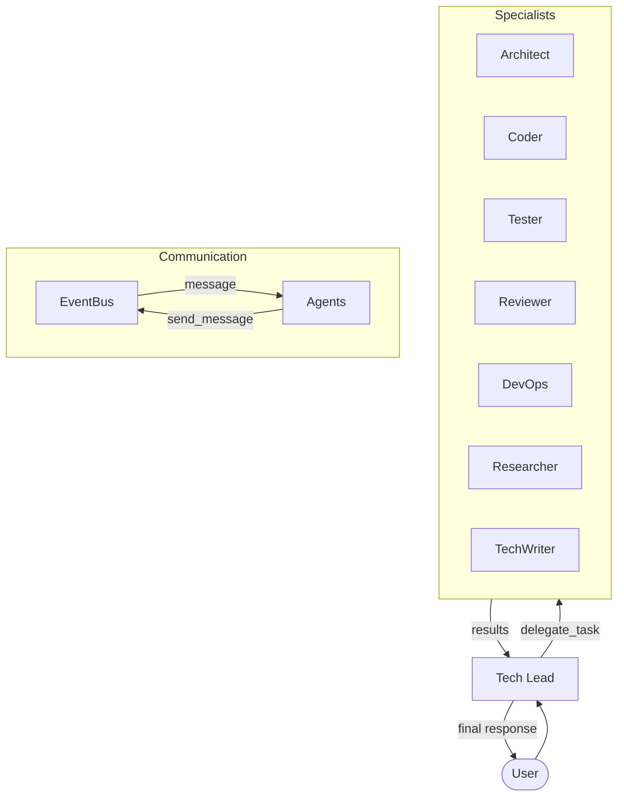

# Multi-Agent System

Henchman v0.2.0 introduces a powerful multi-agent orchestration system that simulates a full software development team. Instead of a single general-purpose agent, Henchman now coordinates specialist agents to solve complex tasks with greater precision and reliability.

## Architecture

At the core of the system is the **Orchestrator**, which manages a team of specialist agents.



### Key Components

- **Orchestrator**: The brain of the team. It receives user input, delegates to specialists, and synthesizes results.
- **EventBus**: A pub/sub system that allows agents to communicate with each other asynchronously.
- **AgentPool**: Manages the lifecycle and instantiation of agents, providing scoped tool access and role-specific prompts.

## Agent Roster

### Tech Lead (Orchestrator Agent)
- **Role**: Team lead and strategist.
- **Responsibilities**: Decomposes user requirements, delegates to specialists, and ensures final quality.
- **Tools**: Full tool access + `delegate_task`.

### Architect
- **Role**: System designer.
- **Responsibilities**: Creates technical plans, designs APIs, and evaluates trade-offs.
- **Tools**: Read-only access to codebase and external research.

### Coder
- **Role**: Implementation specialist.
- **Responsibilities**: Writes and refactors code, fixes bugs, and follows project conventions.
- **Tools**: Full access to file editing and shell commands.

### Reviewer
- **Role**: Quality control.
- **Responsibilities**: Audits code for bugs, security issues, and style violations.
- **Tools**: Read-only access to codebase.

### Tester
- **Role**: Verification specialist.
- **Responsibilities**: Writes unit and integration tests, runs test suites, and finds regressions.
- **Tools**: Full file access and shell commands for running tests.

### DevOps / CI
- **Role**: Infrastructure and build specialist.
- **Responsibilities**: Manages CI pipelines, build status, and environment configuration.
- **Tools**: Shell access, network tools, and file management.

### Researcher
- **Role**: Information gatherer.
- **Responsibilities**: Searches documentation, explores APIs, and synthesizes research briefs.
- **Tools**: Web search, web fetch, and RAG search.

### Technical Writer
- **Role**: Documentation specialist.
- **Responsibilities**: Writes READMEs, API docs, and changelogs.
- **Tools**: File writing and editing.

## Usage

### Interactive Mode
By default, you talk to the **Tech Lead**. They will automatically delegate tasks to specialists as needed.

```bash
mlg
❯ Implement a new authentication module
```

### Direct Targeting
You can talk to a specific agent directly using the `/agent` command:

```
❯ /agent coder Fix the indentation in auth.py
```

Or from the command line:

```bash
mlg --agent researcher --prompt "How do I use the FastAPI background tasks?"
```

### Team Management
- `/agent list`: Show all available agents and their current status.
- `/agent config <role>`: View the configuration for a specific agent.
- `/team status`: See detailed status of the whole team and recent shared decisions.
- `/team reset`: Reset the conversation history for all agents in the team.

## Configuration

You can customize the team in your `settings.yaml`:

```yaml
agents:
  # Max recursive delegation depth
  max_delegation_depth: 3
  
  # Agent overrides
  agents:
    coder:
      model: "gpt-4o"  # Give the coder a more powerful model
    architect:
      enabled: true
    security_auditor:  # Add a custom specialist
      name: "Security Auditor"
      role: "security_auditor"
      description: "Audits code for security"
      tools: ["read_file", "grep"]
      can_delegate_to: ["researcher"]
```
