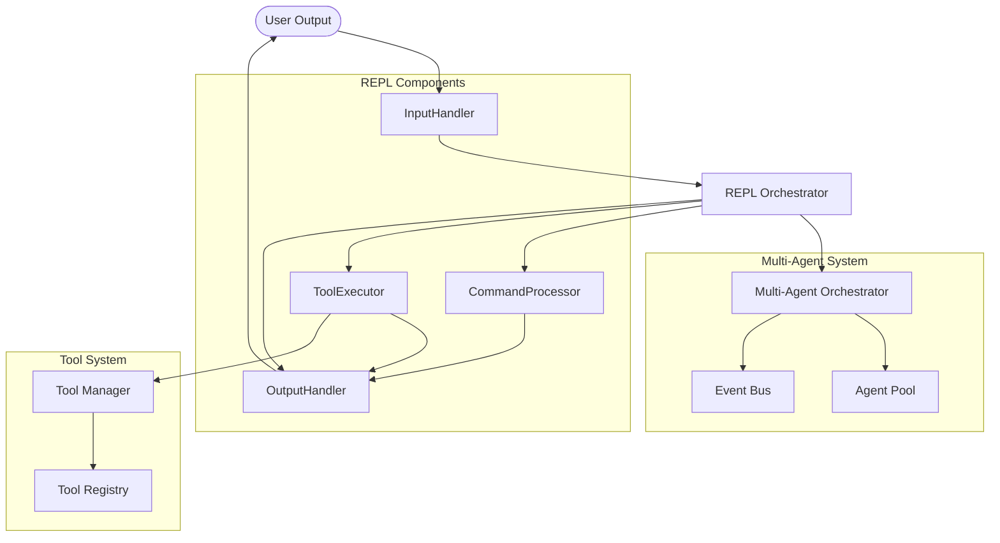

# System Architecture

## Overview

Henchman-AI is built with a modular, component-based architecture that separates concerns and promotes maintainability. The system is designed around the principle of single responsibility, with each component handling a specific aspect of the CLI's functionality.

## Core Architecture

### High-Level Component Diagram



## Component Details

### REPL (Read-Eval-Print Loop)

**Location**: `src/henchman/cli/repl.py`  
**Lines**: 406 (reduced from 559, 27% reduction)  
**Role**: Main orchestrator and coordinator

The REPL class is the central coordinator that initializes and connects all components. It manages the main interaction loop and delegates work to specialized components.

**Responsibilities**:
- Initialize all component instances
- Manage the main interaction loop (`run()` method)
- Delegate input processing to `InputHandler`
- Delegate output handling to `OutputHandler`
- Delegate command execution to `CommandProcessor`
- Delegate tool execution to `ToolExecutor`
- Maintain backward compatibility with existing API

**Key Methods**:
- `__init__()`: Initialize all components
- `run()`: Main interaction loop
- `process_input()`: Route input to appropriate handler
- `_run_agent()`: Coordinate agent execution

### InputHandler

**Location**: `src/henchman/cli/input_handler.py`  
**Lines**: 32  
**Role**: User input processing and management

Handles all aspects of user input including prompt sessions, history, and input validation.

**Responsibilities**:
- Manage `prompt_toolkit` prompt sessions
- Handle @file expansion (e.g., `@filename.txt`)
- Detect slash commands (e.g., `/quit`, `/clear`)
- Process keyboard interrupts (Ctrl+C) and EOF (Ctrl+D)
- Validate and sanitize user input

**Key Methods**:
- `initialize_prompt_session()`: Set up prompt session with toolbar
- `get_input()`: Get user input with error handling
- `process_input()`: Process and classify input
- `is_slash_command()`: Detect command vs regular input

### OutputHandler

**Location**: `src/henchman/cli/output_handler.py`  
**Lines**: 93  
**Role**: Console output, status display, and event streaming

Manages all console output including rich formatting, status bars, and event display.

**Responsibilities**:
- Display welcome and goodbye messages
- Show status bars with provider/model information
- Display tool counts and MCP server status
- Handle event streaming from agents
- Show turn status with progress indicators
- Manage RAG background indexing status

**Key Methods**:
- `print_welcome()`: Display welcome message
- `print_goodbye()`: Display exit message
- `get_toolbar_status()`: Generate status bar content
- `get_rich_status_message()`: Generate agent status message
- `create_status()`: Create rich status context manager
- `show_turn_status()`: Display turn progress

### CommandProcessor

**Location**: `src/henchman/cli/command_processor.py`  
**Lines**: 39  
**Role**: Slash command execution and management

Processes all slash commands and delegates to appropriate command handlers.

**Responsibilities**:
- Parse and validate slash commands
- Route commands to registered command handlers
- Handle built-in commands (`/quit`, `/clear`, `/help`)
- Support command arguments and options
- Provide error handling for invalid commands

**Key Methods**:
- `handle_command()`: Process a slash command
- `get_command_registry()`: Access command registry
- Command-specific handlers for built-in commands

### ToolExecutor

**Location**: `src/henchman/cli/tool_executor.py`  
**Lines**: 178  
**Role**: Tool execution and agent coordination

Executes tool calls from agents and manages tool confirmation workflows.

**Responsibilities**:
- Execute tool calls from agent streams
- Handle tool confirmation requests
- Manage tool iteration limits and cancellation
- Process agent event streams
- Coordinate with `ToolManager` for tool execution

**Key Methods**:
- `process_agent_stream()`: Process agent event stream
- `execute_tool_calls()`: Execute batch of tool calls
- `handle_tool_call()`: Handle single tool call
- `handle_confirmation()`: Process tool confirmation requests

## Data Flow

### Interactive Session Flow

1. **Input Phase**:
   ```
   User → InputHandler.get_input() → REPL.process_input()
   ```

2. **Command Processing**:
   ```
   Slash command → CommandProcessor.handle_command() → OutputHandler
   Regular input → REPL._run_agent() → ToolExecutor
   ```

3. **Agent Execution**:
   ```
   ToolExecutor.process_agent_stream() → ToolManager → Tool execution → OutputHandler
   ```

4. **Output Phase**:
   ```
   OutputHandler → Console display → User
   ```

### Component Communication

Components communicate through well-defined interfaces:

1. **REPL to Components**: Direct method calls with dependency injection
2. **Components to REPL**: Callbacks and event handlers
3. **Component to Component**: Through shared references (e.g., `output_handler.session_manager`)

## Design Principles

### SOLID Principles Applied

1. **Single Responsibility**: Each component has one clear purpose
2. **Open/Closed**: Components are open for extension, closed for modification
3. **Liskov Substitution**: Components can be replaced with compatible implementations
4. **Interface Segregation**: Components have focused, minimal interfaces
5. **Dependency Inversion**: Components depend on abstractions, not concretions

### Testing Strategy

- **Unit Tests**: Each component tested independently (100% coverage for core components)
- **Integration Tests**: Component coordination tested in `test_repl_integration.py`
- **End-to-End Tests**: Full workflow tests in `test_repl.py`

### Performance Considerations

- **Async-First**: All I/O operations are asynchronous
- **Lazy Initialization**: Components initialized on-demand
- **Caching**: Frequent operations cached where appropriate
- **Streaming**: Event streaming for real-time feedback

## Extension Points

### Adding New Components

1. Create component class in `src/henchman/cli/`
2. Implement focused interface
3. Update REPL initialization
4. Add unit tests
5. Update integration tests

### Customizing Existing Components

1. Subclass component
2. Override specific methods
3. Pass custom instance to REPL constructor
4. Maintain backward compatibility

## Migration and Compatibility

### Backward Compatibility

The refactored architecture maintains full backward compatibility:

1. **Public API unchanged**: All existing methods preserved
2. **Attribute access**: Legacy attributes (`repl.agent`, `repl.tool_registry`) maintained
3. **Test compatibility**: All existing tests pass without modification
4. **External dependencies**: No breaking changes to external interfaces

### Future Evolution

The component architecture enables future enhancements:

1. **Plugin system**: Components can be swapped or extended
2. **Configuration**: Component behavior configurable via settings
3. **Monitoring**: Component-level metrics and logging
4. **Optimization**: Independent optimization of each component

## References

- [Multi-Agent System](agents.md) - Details on the agent orchestration layer
- [Tool System](tools.md) - Information about the tool registry and execution
- [Configuration Guide](configuration.md) - How to configure component behavior
- [API Reference](api.md) - Detailed API documentation for each component