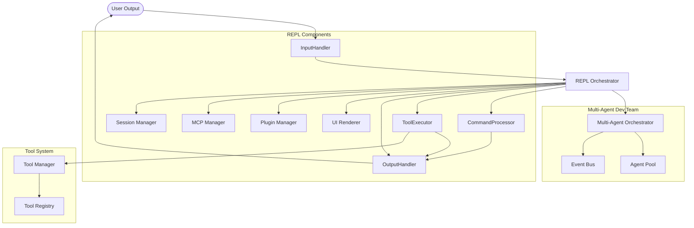

# System Architecture

## Overview

Henchman-AI is built with a modular, component-based architecture that separates concerns and promotes maintainability. The system is designed around the principle of single responsibility, with each component handling a specific aspect of the CLI's functionality.

## Core Architecture

### High-Level Component Diagram



## Component Details

### REPL (Read-Eval-Print Loop)

**Location**: `src/henchman/cli/repl.py`  
**Lines**: 532  
**Role**: Main orchestrator and coordinator

The REPL class is the central coordinator that initializes and connects all components. It manages the main interaction loop and delegates work to specialized components.

**Responsibilities**:
- Initialize all component instances
- Manage the main interaction loop (`run()` method)
- Delegate input processing to `InputHandler`
- Delegate output handling to `OutputHandler` and `UIRenderer`
- Delegate command execution to `CommandProcessor`
- Delegate tool execution to `ToolExecutor`
- Manage plugins via `PluginManager`
- Manage MCP servers via `McpManager`
- Handle sessions via `SessionManager`
- Maintain backward compatibility with existing API

**Key Methods**:
- `__init__()`: Initialize all components
- `run()`: Main interaction loop
- `process_input()`: Route input to appropriate handler
- `_run_agent()`: Coordinate agent execution
- `_init_renderer()`: Initialize UI renderer
- `_init_tool_manager()`: Initialize tool system
- `_init_mcp_manager()`: Initialize MCP connections
- `_init_plugin_manager()`: Load plugins
- `_init_orchestrator()`: Create multi-agent system
- `_init_handlers()`: Initialize output and command handlers
- `_init_tool_executor()`: Initialize tool execution
- `_init_input_handler()`: Initialize input handling

### UIRenderer

**Location**: `src/henchman/cli/ui_renderer.py`  
**Lines**: 337  
**Role**: Rich console output and UI rendering

Handles all rich console output including formatting, progress bars, and status displays.

**Responsibilities**:
- Render rich console output with themes
- Display progress bars and status indicators
- Handle thinking indicators and animations
- Manage console formatting and styling
- Support accessible mode for screen readers

**Key Methods**:
- `print_welcome()`: Display welcome message
- `print_goodbye()`: Display exit message
- `start_thinking()`: Show thinking indicator
- `stop_thinking()`: Hide thinking indicator
- `show_thinking()`: Display thinking content
- `print_newline()`: Print blank line with proper styling

### InputHandler

**Location**: `src/henchman/cli/input_handler.py`  
**Lines**: 165  
**Role**: User input processing and management

Handles all aspects of user input including prompt sessions, history, and input validation.

**Responsibilities**:
- Manage `prompt_toolkit` prompt sessions
- Handle @file expansion (e.g., `@filename.txt`)
- Detect slash commands (e.g., `/quit`, `/clear`)
- Process keyboard interrupts (Ctrl+C) and EOF (Ctrl+D)
- Validate and sanitize user input
- Support custom keybindings from settings

**Key Methods**:
- `initialize_prompt_session()`: Set up prompt session with toolbar
- `get_input()`: Get user input with error handling
- `process_input()`: Process and classify input
- `is_slash_command()`: Detect command vs regular input
- `expand_at_references()`: Expand @file references

### OutputHandler

**Location**: `src/henchman/cli/output_handler.py`  
**Lines**: 339  
**Role**: Console output, status display, and event streaming

Manages all console output including rich formatting, status bars, and event display.

**Responsibilities**:
- Display welcome and goodbye messages
- Show status bars with provider/model information
- Display tool counts and MCP server status
- Handle event streaming from agents
- Show turn status with progress indicators
- Manage RAG background indexing status
- Coordinate with `UIRenderer` for actual output

**Key Methods**:
- `print_welcome()`: Display welcome message
- `print_goodbye()`: Display exit message
- `get_toolbar_status()`: Generate status bar content
- `get_rich_status_message()`: Generate agent status message
- `create_status()`: Create rich status context manager
- `show_turn_status()`: Display turn progress

### CommandProcessor

**Location**: `src/henchman/cli/command_processor.py`  
**Lines**: 130  
**Role**: Slash command execution and management

Processes all slash commands and delegates to appropriate command handlers.

**Responsibilities**:
- Parse and validate slash commands
- Route commands to registered command handlers
- Handle built-in commands (`/quit`, `/clear`, `/help`, `/tools`, `/mcp`, `/extensions`)
- Support command arguments and options
- Provide error handling for invalid commands
- Integrate with plugin command system

**Key Methods**:
- `handle_command()`: Process a slash command
- `get_command_registry()`: Access command registry
- Command-specific handlers for built-in commands

### ToolExecutor

**Location**: `src/henchman/cli/tool_executor.py`  
**Lines**: 287  
**Role**: Tool execution and agent coordination

Executes tool calls from agents and manages tool confirmation workflows.

**Responsibilities**:
- Execute tool calls from agent streams
- Handle tool confirmation requests
- Manage tool iteration limits and cancellation
- Process agent event streams
- Coordinate with `ToolManager` for tool execution
- Handle tool retry logic and error recovery

**Key Methods**:
- `process_agent_stream()`: Process agent event stream
- `execute_tool_calls()`: Execute batch of tool calls
- `handle_tool_call()`: Handle single tool call
- `handle_confirmation()`: Process tool confirmation requests

### ToolManager

**Location**: `src/henchman/cli/tool_manager.py`  
**Lines**: 161  
**Role**: Tool registration and management

Manages the tool registry and provides tool-related services.

**Responsibilities**:
- Register built-in tools
- Manage tool confirmation policies
- Handle auto-approve settings
- Provide tool declarations for LLMs
- Integrate with MCP tools

**Key Methods**:
- `register_builtin_tools()`: Register all built-in tools
- `set_confirmation_handler()`: Set tool confirmation handler
- `set_auto_approve()`: Configure auto-approve behavior
- `set_plan_mode()`: Enable/disable plan mode

### PluginManager

**Location**: `src/henchman/cli/plugins.py`  
**Lines**: 164  
**Role**: Plugin loading and management

Manages plugin discovery, loading, and integration.

**Responsibilities**:
- Discover plugins in configured directories
- Load and initialize plugins
- Register plugin tools and commands
- Handle plugin lifecycle

**Key Methods**:
- `load_plugins_from_directory()`: Load plugins from directory
- `register_plugin()`: Register a plugin instance
- `unregister_plugin()`: Remove a plugin

### McpManager

**Location**: `src/henchman/mcp/manager.py`  
**Lines**: 209  
**Role**: MCP (Model Context Protocol) server management

Manages connections to MCP servers and provides MCP tools.

**Responsibilities**:
- Connect to configured MCP servers
- Discover tools from MCP servers
- Handle MCP tool execution
- Manage MCP server lifecycle

**Key Methods**:
- `connect_all()`: Connect to all configured servers
- `disconnect_all()`: Disconnect from all servers
- `get_all_tools()`: Get all available MCP tools

### SessionManager

**Location**: `src/henchman/cli/session_manager.py`  
**Lines**: 321  
**Role**: Session management and persistence

Manages chat sessions including saving, loading, and resuming.

**Responsibilities**:
- Save and load chat sessions
- Manage session templates
- Handle session auto-save
- Integrate with agent history

**Key Methods**:
- `set_session()`: Set current session
- `save_session()`: Save session to disk
- `load_session()`: Load session from disk
- `list_templates()`: List available session templates

## Data Flow

### Interactive Session Flow

1. **Input Phase**:
   ```
   User → InputHandler.get_input() → REPL.process_input()
   ```

2. **Command Processing**:
   ```
   Slash command → CommandProcessor.handle_command() → OutputHandler → UIRenderer → User
   Regular input → REPL._run_agent() → ToolExecutor
   ```

3. **Agent Execution**:
   ```
   ToolExecutor.process_agent_stream() → 
     → ToolManager → Tool execution → 
     → Orchestrator → AgentPool → EventBus → 
     → OutputHandler → UIRenderer → User
   ```

4. **Plugin Integration**:
   ```
   PluginManager → Load plugins → Register tools/commands → 
     → ToolManager/CommandProcessor → Available to user
   ```

5. **MCP Integration**:
   ```
   McpManager → Connect to servers → Discover tools → 
     → ToolManager → Available as tools → Agent execution
   ```

6. **Session Management**:
   ```
   SessionManager → Save/load sessions → 
     → REPL session state → Agent history persistence
   ```

### Component Communication

Components communicate through well-defined interfaces:

1. **REPL to Components**: Direct method calls with dependency injection
2. **Components to REPL**: Callbacks and event handlers
3. **Component to Component**: Through shared references and interfaces
4. **Event-Based Communication**: `EventBus` for agent system events
5. **Plugin Hooks**: Extension points for plugin integration

## Design Principles

### SOLID Principles Applied

1. **Single Responsibility**: Each component has one clear purpose
2. **Open/Closed**: Components are open for extension, closed for modification
3. **Liskov Substitution**: Components can be replaced with compatible implementations
4. **Interface Segregation**: Components have focused, minimal interfaces
5. **Dependency Inversion**: Components depend on abstractions, not concretions

### Architectural Patterns

1. **Facade Pattern**: REPL provides simplified interface to complex subsystem
2. **Observer Pattern**: EventBus enables decoupled component communication
3. **Strategy Pattern**: Tool system allows different execution strategies
4. **Plugin Pattern**: Extensible architecture via plugin system
5. **Bridge Pattern**: UI abstraction separates rendering from logic

### Testing Strategy

- **Unit Tests**: Each component tested independently (100% coverage for core components)
- **Integration Tests**: Component coordination tested in `test_repl_integration.py`
- **End-to-End Tests**: Full workflow tests in `test_repl.py`
- **Plugin Tests**: Plugin system tests in `test_plugins.py`
- **MCP Tests**: MCP integration tests in `test_mcp.py`

### Performance Considerations

- **Async-First**: All I/O operations are asynchronous
- **Lazy Initialization**: Components initialized on-demand
- **Caching**: Frequent operations cached where appropriate
- **Streaming**: Event streaming for real-time feedback
- **Connection Pooling**: MCP connections managed efficiently
- **Background Processing**: RAG indexing and plugin loading in background

## Extension Points

### Adding New Components

1. Create component class in appropriate module
2. Implement focused interface
3. Update REPL initialization if needed
4. Add unit tests
5. Update integration tests

### Plugin Development

1. Create plugin class extending `Extension` base class
2. Implement `get_tools()` and/or `get_commands()` methods
3. Package as installable Python package
4. Register via entry points or directory placement

### MCP Server Integration

1. Configure MCP server in `settings.yaml`
2. Server tools automatically discovered and registered
3. Tools available to agents via tool registry
4. Trusted servers can auto-approve tool execution

### Customizing Existing Components

1. Subclass component
2. Override specific methods
3. Pass custom instance to REPL constructor
4. Maintain backward compatibility
5. Update configuration as needed

## Migration and Compatibility

### Backward Compatibility

The architecture maintains full backward compatibility:

1. **Public API unchanged**: All existing methods preserved
2. **Attribute access**: Legacy attributes (`repl.agent`, `repl.tool_registry`) maintained
3. **Test compatibility**: All existing tests pass without modification
4. **External dependencies**: No breaking changes to external interfaces
5. **Configuration files**: Existing settings files continue to work

### Future Evolution

The component architecture enables future enhancements:

1. **Enhanced Plugin System**: More extension points and lifecycle hooks
2. **Advanced MCP Support**: More protocol features and server types
3. **Distributed Architecture**: Multi-process or multi-machine deployment
4. **Advanced Caching**: Intelligent caching of LLM responses and tool results
5. **Metrics and Monitoring**: Comprehensive performance tracking
6. **UI Framework**: Alternative UI frameworks (TUI, Web, Desktop)

## System Evolution

### From Simple CLI to Multi-Agent Platform

The architecture has evolved from a simple CLI to a comprehensive multi-agent platform:

1. **Phase 1-6**: Basic CLI with single agent and tools
2. **Phase 7-8**: Session management and terminal UI
3. **Phase 9**: MCP integration for external tool servers
4. **Phase 10**: Plugin system for extensibility
5. **Phase 11**: Advanced features (multiple providers, JSON output)
6. **Phase 12**: Polish and release readiness
7. **Phase 13**: Multi-agent dev team with specialized roles

### Current Architecture Benefits

1. **Modularity**: Components can be developed and tested independently
2. **Extensibility**: Plugin and MCP systems enable easy extension
3. **Maintainability**: Clear separation of concerns reduces complexity
4. **Testability**: Well-defined interfaces enable comprehensive testing
5. **Scalability**: Architecture supports adding new components and features
6. **User Experience**: Rich UI and responsive interaction

## References

- [Multi-Agent Dev Team](agents.md) - Details on the agent orchestration layer
- [Tool System](tools.md) - Information about the tool registry and execution
- [Configuration Guide](configuration.md) - How to configure component behavior
- [API Reference](api.md) - Detailed API documentation for each component
- [MCP Integration](mcp.md) - Model Context Protocol server integration
- [Extensions Guide](extensions.md) - Plugin system and extension development